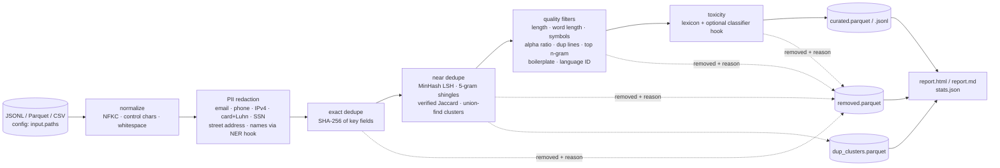
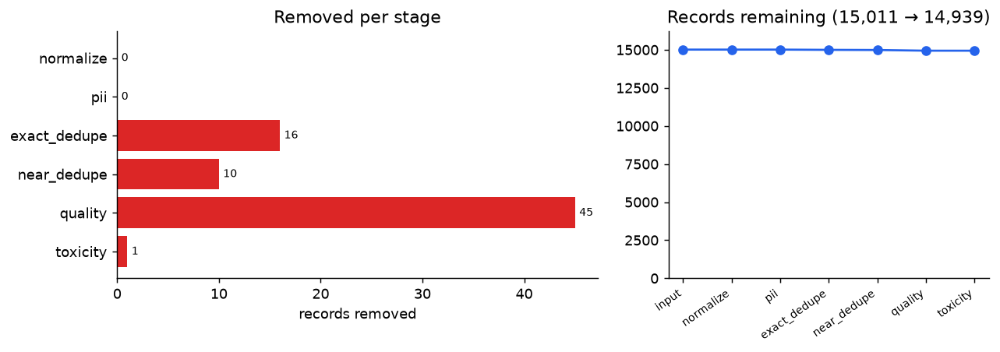
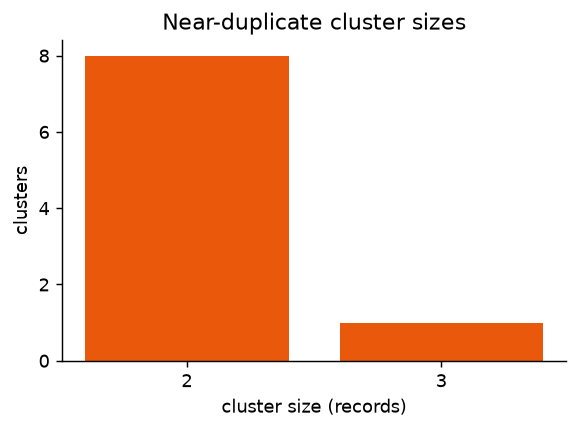

# llm-dataset-curation

[](https://github.com/SuperJohn/llm-dataset-curation/actions/workflows/ci.yml)
 

A config-driven pipeline for cleaning instruction or pretraining text before it goes
anywhere near a model. It normalizes, removes **exact and near duplicates (MinHash
LSH)**, applies **Gopher/C4-style quality heuristics** and fastText language ID, **redacts PII**,
filters **toxic** content, and writes an **eval report** that shows exactly what was
removed and why.

```bash
uv sync
uv run curate run --config configs/sample.yaml   # offline, ~5 s
open output/dolly-sample/report.html
```

📊 **[Example report on all of databricks-dolly-15k →](docs/example-report/report.md)**

## Why this exists

Data quality is the highest-leverage, least glamorous part of training a model. This
repo is a compact, testable version of the curation stages used in large-scale
pipelines, built the way I'd want a production data job to look:

- **Declarative:** every threshold lives in YAML, and any of them can be overridden from the CLI
  (`--set stages.near_dedupe.threshold=0.7`).
- **Auditable:** every removed record keeps its stage and a human-readable reason
  (`near duplicate of dolly-01279 (J≈0.95)`, `repetitive top 2-gram covers 36% of text`),
  and every kept record carries its quality signals, so thresholds get tuned from data,
  not vibes.
- **Safe by construction:** PII is redacted *immediately after normalization*, so no
  downstream artifact (dedupe clusters, removed samples, the report) ever holds raw PII.
- **Tested against labelled noise:** the sample includes 33 synthetic "bad" records
  (whitespace and Unicode duplicates, light paraphrases, fake PII, other languages, spam,
  boilerplate, insults). A test asserts that each one is caught by the *right* stage.

## Pipeline



| Stage | What it does | Key config |
|---|---|---|
| `normalize` | Unicode NFKC, strips zero-width and control characters, collapses whitespace, rebuilds `text` from `input.text_fields` | `unicode_form` |
| `pii` | Regex redaction to typed placeholders (`<EMAIL>`, `<PHONE>`, …). Card numbers must pass Luhn. Opt-in `street_address` (US regex) and `person_name` (NER hook, e.g. spaCy via the `ner` extra). Optionally drops PII-dense records. | `types`, `ner`, `action: redact\|drop`, `max_hits_before_drop` |
| `exact_dedupe` | SHA-256 over the chosen fields (case-insensitive) and keeps the first occurrence | `fields` |
| `near_dedupe` | MinHash (128 perms) over word 5-grams, LSH candidates **verified** by estimated Jaccard, and union-find clusters that keep the earliest record | `threshold`, `ngram`, `num_perm`, `min_words`, `fields` |
| `quality` | Gopher-style rules: word count, mean word length, `#`/ellipsis ratio, alphabetic-word fraction, duplicate-line fraction (per field), top 2/3/4-gram character coverage, banned boilerplate phrases, and language ID (fastText `lid.176`: best label among common languages, gated on its raw probability) | `min_words`, `max_top_ngram_char_fraction`, `language.*` |
| `toxicity` | Whole-word lexicon matching (phrases allowed) with hit count and fraction thresholds. Any `module:function` scorer can be plugged in (e.g. Detoxify). | `lexicon_paths`, `max_hits`, `classifier` |

For instruction data, the **identity of an example is `instruction + response`**, so
several questions about the same context passage are *not* duplicates. Language ID runs
on the **prompt**, because responses are often lists of proper nouns, and translation
tasks legitimately answer in another language.

### Language ID

Language ID uses Facebook's fastText [`lid.176`](https://fasttext.cc/docs/en/language-identification.html)
model (compressed `.ftz`, ~0.9 MB, CC BY-SA 3.0). It is downloaded once to
`~/.cache/curate/` (or `$XDG_CACHE_HOME/curate/`) with a pinned SHA-256, and every run
after that is offline. Set `CURATE_LID_MODEL=/path/to/lid.176.ftz` on air-gapped machines,
or point it at the 131 MB `lid.176.bin`, which did better on the name-heavy and "pour over
coffee" prompts in spot checks. A record is dropped only when a disallowed language scores at least
`language.min_confidence`, using fastText's own probability. It is not renormalised over the
candidate list, so an English question full of foreign names stays low-confidence instead
of becoming a confident Spanish call.

It replaced py3langid ([#2](https://github.com/SuperJohn/llm-dataset-curation/issues/2)).
`scripts/benchmark_langid.py` scores both on
[37 labelled prompts](data/benchmarks/langid_prompts.jsonl): 25 English questions dense with
foreign proper nouns ("Who was Octávio Tarquínio de Sousa?", "Who was Hô Chí Minh?") and
12 short prompts in 9 other languages.

| Detector | English false flags @ 0.5 | @ 0.9 | Non-English recall @ 0.5 | @ 0.9 | Dolly-15k prompts flagged @ 0.9 |
|---|---:|---:|---:|---:|---:|
| py3langid (before) | 11 / 25 | 9 / 25 | 100% | 100% | 4 (3 English) |
| fastText `lid.176.ftz` | **1 / 25** | **1 / 25** | 100% | 92% | **2 (1 English)** |

The remaining fastText miss is "How do I make good pour over coffee?", which comes out
French at 0.97 because of *pour*. At 0.9, the Swedish prompt (0.84) also slips through.

## Results

| Run | In | Kept | Exact dup | Near dup | Quality | Toxic | PII redacted | Runtime |
|---|---:|---:|---:|---:|---:|---:|---:|---:|
| `configs/sample.yaml` (1,500 Dolly + 33 synthetic) | 1,533 | 1,482 | 22 | 11 | 16 | 2 | 14 records | ~5 s |
| `configs/dolly15k.yaml` (full dataset) | 15,011 | 14,941 | 16 | 10 | 43 | 1 | 11 records (22 hits) | ~15 s |

The [example report](docs/example-report/report.md) includes the funnel, the length
distribution before and after, near-duplicate cluster sizes with examples, PII hit rates
by type, and samples of removed records for each stage.

<p>


</p>

## Usage

```bash
make setup                    # uv sync
make run                      # curate the checked-in sample
make full                     # download databricks-dolly-15k (13 MB) and curate all of it
make test                     # ruff + pytest
make notebook                 # open the offline walkthrough notebook (needs --extra notebook)

uv run curate run -c configs/sample.yaml \
    --set stages.near_dedupe.threshold=0.7 \
    --set stages.mitigation.pii.action=drop
uv run curate validate -c configs/sample.yaml   # print the fully-resolved config
uv run python scripts/benchmark_langid.py       # fastText vs py3langid (add --dolly data/raw/dolly-15k.jsonl)
```

Outputs, written to `output.dir`:

```
curated.parquet / curated.jsonl   # kept records + quality signals + pii_hits / pii_types
removed.parquet                   # every removed record with _stage and _reason
dup_clusters.parquet              # cluster_id, member, representative, est. Jaccard
stats.json                        # funnel + per-stage stats + timings
report.html / report.md           # eval report (HTML is self-contained)
```

Step-by-step offline walkthrough (Python API + report exploration):
[`notebooks/walkthrough.ipynb`](notebooks/walkthrough.ipynb). Install the optional
Jupyter bits with `uv sync --extra notebook`, then `make notebook`.

Bringing your own data takes one config: point `input.paths` at JSONL, Parquet, or CSV, and
set `id_field` and `text_fields`.

## Layout

```
src/curate/
  cli.py            # curate run | download | validate
  config.py         # pydantic models for the YAML config
  io.py             # readers, combined-text builder, writers
  langid.py         # fastText lid.176 download, cache, and language detection
  pipeline.py       # stage orchestration + funnel accounting
  report.py         # matplotlib charts, DuckDB summaries, HTML/Markdown report
  classifiers.py    # optional toxicity-classifier hooks
  stages/           # normalize, dedupe, quality, mitigation
configs/            # sample.yaml (offline), dolly15k.yaml (full)
lexicons/           # toxicity lexicon (extend or replace)
data/sample/        # 1,500-record Dolly subset + 33 labelled synthetic noise records
data/benchmarks/    # labelled prompts for the language-ID benchmark
scripts/            # synthetic noise generator, language-ID benchmark
notebooks/          # offline walkthrough of a sample run
tests/              # unit tests per stage + end-to-end + CLI + packaging
```

## Known limitations & next steps

- **Language ID still misses on short prompts with a loaded word.** fastText `lid.176` fixed
  most false flags on English prompts full of foreign names (11 → 1 of 25 on the benchmark),
  but "How do I make good pour over coffee?" still comes out French. Next steps: per-language
  confidence thresholds, or a second vote from the response for short prompts.
- **The lexicon toxicity filter is deliberately crude.** On Dolly it flags one
  creative-writing prompt ("the cat should be hostile toward the dog"). The classifier hook
  is there for a real model such as Detoxify, or a small fine-tuned classifier.
- **Name and address PII is best-effort.** Street addresses use a US-format regex, so
  non-US formats and addresses without a numbered street slip through. Names need an NER
  hook (`pii.ner: "curate.ner:spacy_person_spans"`). With `en_core_web_sm` on the sample it
  also tags public figures (Dolly is full of them) and one false positive on a clean control
  ("Format a short checklist"), so it is off in `configs/sample.yaml`. Presidio, or a larger
  spaCy model, would slot in behind the same hook.
- **Scale.** Stages run in-process on Polars, which handles a few million records on a laptop.
  For billions: shard the input, run MinHash per shard, and do a global LSH join (e.g. Ray or
  Spark). The stage interfaces were kept pure-function to make that straightforward.
- **More quality signals:** perplexity filtering with a small LM, an instruction/response
  relevance score, and a decontamination check against eval benchmarks (n-gram overlap).


## Install

From a clone (development):

```bash
uv sync
uv sync --extra notebook   # optional: Jupyter for notebooks/walkthrough.ipynb
uv sync --extra ner         # optional: spaCy for person-name PII, then fetch a model:
uv pip install pip && uv run python -m spacy download en_core_web_sm
uv run curate --version
uv run curate run --config configs/sample.yaml
```

From a built wheel:

```bash
uv build                                 # writes dist/*.whl and dist/*.tar.gz
uv pip install dist/llm_dataset_curation-*.whl
curate --version
```

GitHub Releases attach the same artifacts when a `v*` tag is pushed (see below).
PyPI publish is optional and not wired up yet — drop a token into the release
workflow later if you want `twine upload`.

## Cutting a release

Version is single-sourced in `src/curate/__init__.py` (`__version__`); hatchling
reads it for the wheel/sdist metadata.

1. Bump `__version__` (e.g. to `0.1.1`).
2. Commit on `main`, then tag and push:
   ```bash
   git tag v0.1.1
   git push origin main --tags
   ```
3. The **release** workflow (`.github/workflows/release.yml`) runs lint + tests,
   builds the sdist and wheel with `uv build`, uploads them as Actions artifacts,
   and attaches them to a GitHub Release for the tag.
4. You can also trigger a build-only run via **Actions → release → Run workflow**
   (no tag / no GitHub Release).

## Data & license

- [databricks-dolly-15k](https://huggingface.co/datasets/databricks/databricks-dolly-15k)
  by Databricks, licensed **CC BY-SA 3.0**. The in-repo sample and the example report
  contain excerpts of it.
- Synthetic noise records are generated by `scripts/make_synthetic_noise.py`. All "PII" in
  them is fake (example.com addresses, 555 numbers, documentation IP ranges, test card numbers).
- fastText `lid.176` language-ID model by Facebook, licensed **CC BY-SA 3.0**. It is
  downloaded at runtime, not vendored.
- Code: MIT.
