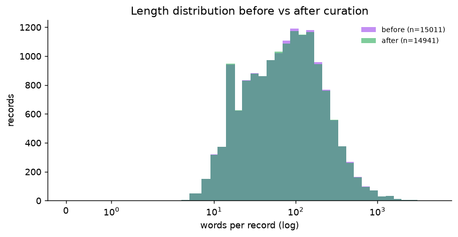
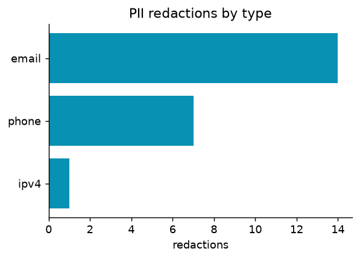

# Curation report — dolly-15k

**15,011** records in → **14,941** kept (**99.5%** retention). PII redacted in 11 records.

## Funnel

| stage | rows in | removed | rows out |
|---|---:|---:|---:|
| input | 15011 | 0 | 15011 |
| normalize | 15011 | 0 | 15011 |
| pii | 15011 | 0 | 15011 |
| exact_dedupe | 15011 | 16 | 14995 |
| near_dedupe | 14995 | 10 | 14985 |
| quality | 14985 | 43 | 14942 |
| toxicity | 14942 | 1 | 14941 |

### Removals by rule

| stage | rule | removed |
|---|---|---:|
| exact_dedupe | — | 16 |
| near_dedupe | — | 10 |
| quality | repetitive_ngrams | 24 |
| quality | duplicate_lines | 9 |
| quality | alpha_fraction | 4 |
| quality | too_short | 3 |
| quality | language | 2 |
| quality | mean_word_length | 1 |
| toxicity | — | 1 |

## Length distribution

| dataset | records | mean_words | p50_words | p95_words | max_words |
|---|---|---|---|---|---|
| before | 15011 | 126.2 | 76.0 | 396.0 | 4435 |
| after | 14941 | 125.6 | 75.0 | 392.0 | 4435 |

## Near-duplicate clusters

**Cluster `dolly-05992`**

| id | rep | Ĵ | text |
|---|---|---|---|
| dolly-05992 | ✓ |  | Give me a one line summary of the story below: ⏎  ⏎ A long long time ago the Queen of Odisha heard that there was a master stone sculptor who made such stunning sta |
| dolly-10921 |  | 0.89 | Give me a one line summary of the story below: ⏎  ⏎ A long long time ago the Queen of Odisha heard that there was a master stone sculptor who made such stunning sta |
| dolly-11562 |  | 0.88 | Give me a one line summary of the story below: ⏎  ⏎ A long long time ago the Queen of Odisha heard that there was a master stone sculptor who made such stunning sta |

**Cluster `dolly-00339`**

| id | rep | Ĵ | text |
|---|---|---|---|
| dolly-00339 | ✓ |  | I'm going to give you a passage from Marty Essen's book "Cool Creatures, Hot Planet: Exploring the Seven Continents" and want you to answer the following questi |
| dolly-05741 |  | 0.93 | I'm going to give you a passage from Marty Essen's book "Cool Creatures, Hot Planet: Exploring the Seven Continents" and want you to answer the following questi |

**Cluster `dolly-01118`**

| id | rep | Ĵ | text |
|---|---|---|---|
| dolly-01118 | ✓ |  | What's the differences of the Wing Chun kongfu and the traditional Shaolin Kongfu? ⏎  ⏎ Wing chun was invented by a Buddhist nun who watched a snake and crane fight |
| dolly-06489 |  | 0.96 | What's the differences of the Wing Chun kongfu and the traditional Shaolin Kongfu? ⏎  ⏎ Wing chun was invented by a Buddhist nun who watched a snake and crane fight |

## PII

Hit rate 0.07% of records; action = `redact`.

## Samples of removed records

### exact_dedupe

| id | reason | text (truncated) |
|---|---|---|
| dolly-02958 | exact duplicate of dolly-01113 | Why is the sky blue? ⏎  ⏎ Blue light is scattered in all directions by the tiny molecules of air in Earth's atmosphere. Blue is scattered more than other colors because it travels as shorter, smaller wave |
| dolly-06010 | exact duplicate of dolly-03117 | Why is Pickleball sport so popular ⏎  ⏎ Pickleball is so popular because anyone can get started fairly easily, as the equipment is not expensive, and there are lot of freely available public courts to pla |
| dolly-06342 | exact duplicate of dolly-04710 | Explain the use of screens in basketball ⏎  ⏎ In basketball, when a team has the ball, one person may set a screen by blocking a defender with his body but making sure his hands are not extended. This all |
| dolly-06702 | exact duplicate of dolly-06669 | What is Categorization and Sentiment Analysis ⏎  ⏎ Categorization and Sentiment Analysis is typically referred in the Customer Experience space where customer interaction data is analyzed to get insights  |
| dolly-07306 | exact duplicate of dolly-00556 | How is data engineering different from data science? ⏎  ⏎ Data Engineering occurs before data science in the data lifecycle. Data can be generated from various sources and this raw data may be structured, |

### near_dedupe

| id | reason | text (truncated) |
|---|---|---|
| dolly-05568 | near duplicate of dolly-01755 (J≈1.0) | Give me a bulleted list of Aaron Fenster's accomplishments. ⏎  ⏎ Aaron Fenster is a medical physicist at the University of Western Ontario Robarts Research Institute in London, Ontario, Canada. He was nam |
| dolly-05741 | near duplicate of dolly-00339 (J≈0.93) | I'm going to give you a passage from Marty Essen's book "Cool Creatures, Hot Planet: Exploring the Seven Continents" and want you to answer the following question: Where are western Hermann's tortoise |
| dolly-05889 | near duplicate of dolly-01279 (J≈0.95) | How can I decide what bike I should get? ⏎  ⏎ When it comes to bicycles for adults, there are different kinds available in the market. Select a bike based on how you'd like to use it. Bikes can be categor |
| dolly-06489 | near duplicate of dolly-01118 (J≈0.96) | What's the differences of the Wing Chun kongfu and the traditional Shaolin Kongfu? ⏎  ⏎ Wing chun was invented by a Buddhist nun who watched a snake and crane fighting. She adopted principles from both st |
| dolly-08304 | near duplicate of dolly-07194 (J≈0.94) | History of the Arches National Park creation. ⏎  ⏎ Humans have occupied the region since the last ice age 10,000 years ago. Fremont people and Ancestral Puebloans lived in the area until about 700 years a |

### quality

| id | reason | text (truncated) |
|---|---|---|
| dolly-00335 | repetitive top 3-gram covers 28% of text | Name all the books in the Harry Potter collection ⏎  ⏎ Here is a list of all the books in the Harry Potter collection written by J.K. Rowling - Harry Potter and the Philosopher's Stone, Harry Potter and t |
| dolly-00780 | repetitive top 2-gram covers 36% of text | Which country has topped the swimming medals list in the summer olympics? ⏎  ⏎ Summary ⏎ Games Year Events Best Nation ⏎ 1 1896 4 Hungary ⏎ 2 1900 7 Great Britain ⏎ 3 1904 9 Germany ⏎ 4 1908 6 Great Britain ⏎ 5 1912  |
| dolly-00839 | alphabetic word fraction 0.34 | Classify each of the following as either a single digit or a double digit number: 8, 4, 1, 12, 87, 65, 3, 5, 45, 97, 6, 2, 34, 71, 9, 48, 0, 7, 31, 50. ⏎  ⏎ Single digits include: 0, 1, 2, 3, 4, 5, 6, 7,  |
| dolly-01101 | repetitive top 2-gram covers 30% of text | Give me list of top 10 countries by GDP ⏎  ⏎ Below is the list of top 10 countries by GDP in 2023: ⏎  ⏎ 1. United States (approx. 26.2 trillion USD) ⏎ 2. China (approx. 19.2 trillion USD) ⏎ 3. Japan (approx. 4.4  |
| dolly-01621 | repetitive top 2-gram covers 32% of text | Which of the following are perfect square roots? Classify them as 'perfect' and 'not perfect' - 1, 23, 4, 6, 9, 10, 42, 112, 81, 100, 55, 16, 32, 25. ⏎  ⏎ 'perfect', 'not perfect', 'perfect', 'not perfect |

### toxicity

| id | reason | text (truncated) |
|---|---|---|
| dolly-09908 | toxic lexicon: 2 hits | Write a letter to a dog, from the perspective of a cat named Mittens, outlining some grievances that the cat has regarding their current living situation. The cat should be hostile toward the dog, and |
